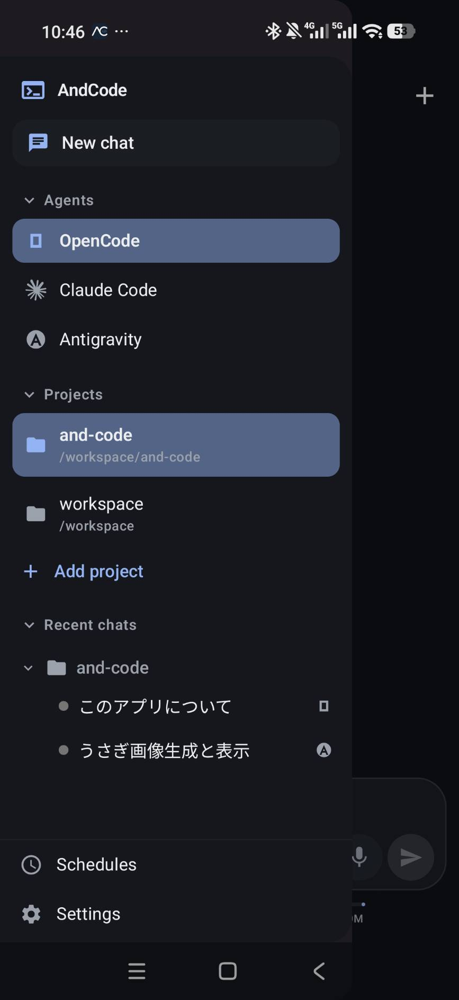
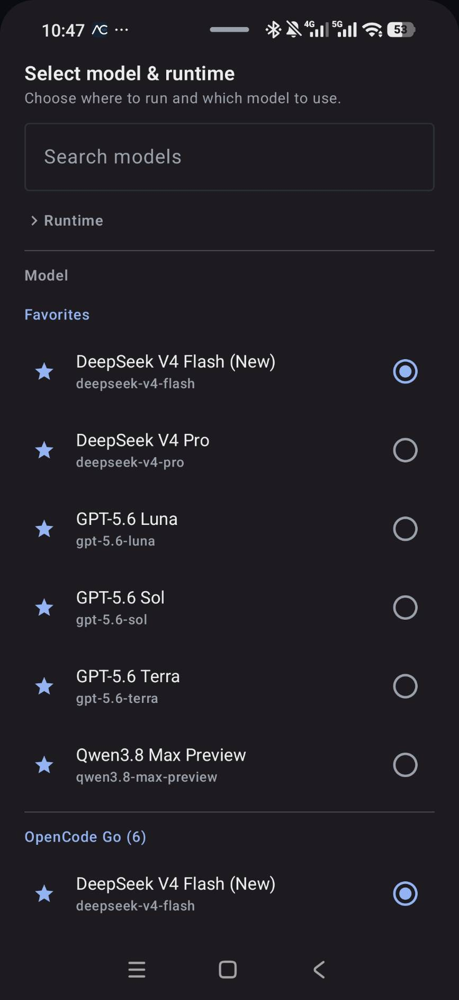
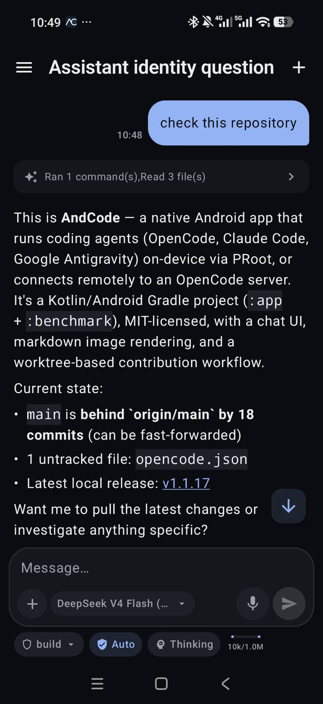
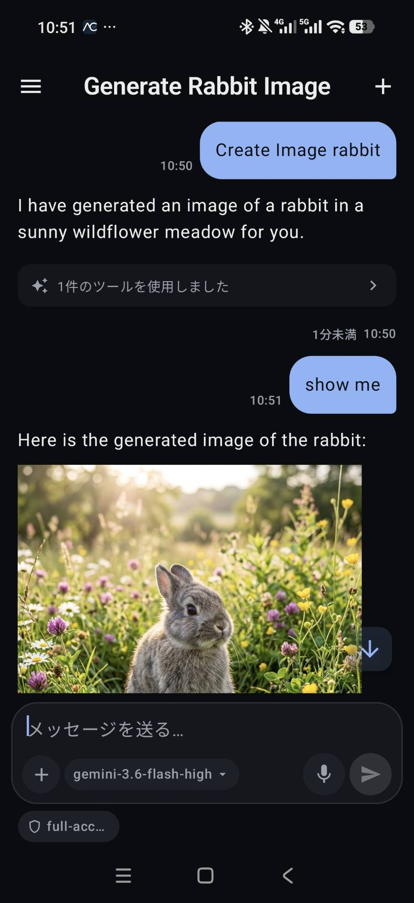
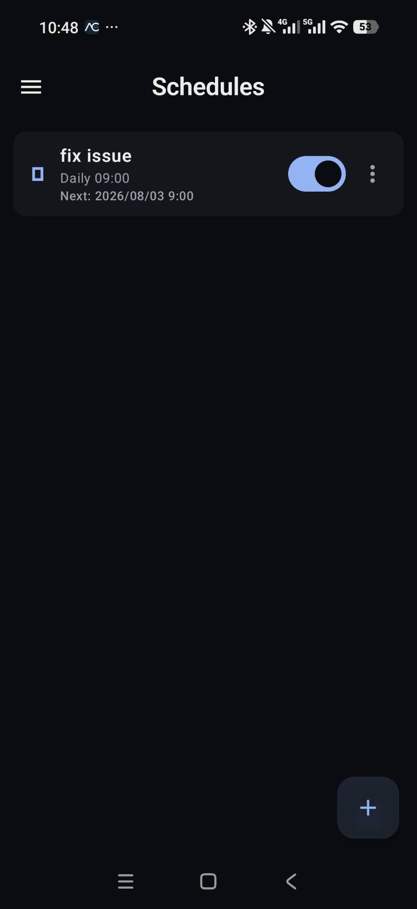
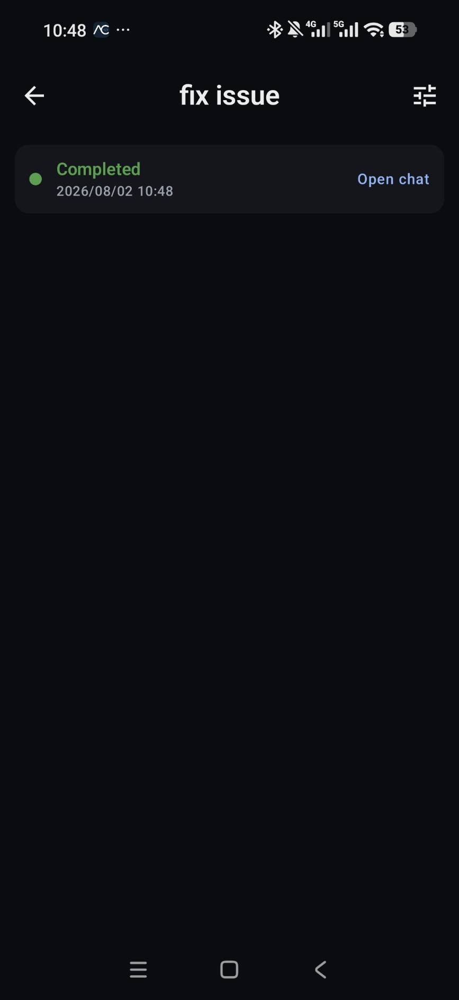

# AndCode

<p align="center">
  <a href="https://github.com/yuga-hashimoto/and-code/actions/workflows/android.yml"></a>
  <a href="https://github.com/yuga-hashimoto/and-code/releases/latest"></a>
  <a href="LICENSE"></a>
  <a href="https://github.com/yuga-hashimoto/and-code/releases/latest"></a>
</p>

**Exécutez des agents de codage IA localement sur Android grâce à une interface graphique native — sans terminal.**

AndCode est une application Android native avec interface graphique qui amène les agents de codage IA sur votre téléphone. Discutez avec [OpenCode](https://github.com/sst/opencode), [Claude Code](https://github.com/anthropics/claude-code), [Google Antigravity](https://github.com/google-antigravity/antigravity-cli) et [OpenAI Codex](https://github.com/openai/codex) via une interface pensée pour le tactile — sans terminal, sans SSH et sans PC pour l'utilisation sur l'appareil. Elle exécute les runtimes des agents via PRoot (sur l'appareil) ou se connecte à distance à votre serveur OpenCode existant sur PC/Mac/Linux.

[Releases](https://github.com/yuga-hashimoto/and-code/releases/latest)

[English](README.md) | [日本語](README.ja.md) | [简体中文](README.zh-CN.md) | [Español](README.es.md) | [Français](README.fr.md) | [Português (Brasil)](README.pt-BR.md) | [Русский](README.ru.md) | [العربية](README.ar.md)

> [!IMPORTANT]
> AndCode est une interface graphique indépendante et local-first qui installe ou lance des outils en ligne de commande tiers pris en charge sur l'appareil Android de l'utilisateur. AndCode ne fournit ni ne revend les services d'IA sous-jacents, les abonnements, l'accès aux modèles ou les droits de compte. L'authentification, l'accès aux modèles, l'inférence et la communication avec les fournisseurs sont gérés par la CLI officielle concernée ou par le fournisseur configuré par l'utilisateur. AndCode n'est ni affilié, ni approuvé, ni sponsorisé, ni officiellement pris en charge par OpenCode, Anthropic, Google ou OpenAI. Voir [Mentions légales et logiciels tiers](#mentions-légales-et-logiciels-tiers) ci-dessous.

<div align="center">

### Captures d'écran

<table>
  <tr>
    <td align="center"><br><em>Tiroir de navigation</em></td>
    <td align="center"><br><em>Sélecteur de modèle et de runtime</em></td>
    <td align="center"><br><em>Conversation sur le dépôt</em></td>
  </tr>
  <tr>
    <td align="center"><br><em>Génération d'images</em></td>
    <td align="center"><br><em>Planifications</em></td>
    <td align="center"><br><em>Résultat de l'exécution</em></td>
  </tr>
</table>

</div>

> [!IMPORTANT]
> AndCode est un projet open source indépendant. Il **n'est pas** affilié à OpenCode, Anthropic, Google ou OpenAI.

---

## Sommaire

- [Agents pris en charge](#agents-pris-en-charge)
- [Fonctionnalités](#fonctionnalités)
- [Antigravity](#antigravity)
- [Codex](#codex)
- [OpenCode à distance](#opencode-à-distance)
- [Écrans](#écrans)
- [Démarrage rapide](#démarrage-rapide)
- [Sécurité](#sécurité)
- [Détails du runtime embarqué](#détails-du-runtime-embarqué)
- [Bascule à chaud (changement de runtime en cours de conversation)](#bascule-à-chaud-changement-de-runtime-en-cours-de-conversation)
- [Connexion à OpenCode Desktop](#connexion-à-opencode-desktop)
- [Compiler depuis les sources](#compiler-depuis-les-sources)
- [Documentation](#documentation)
- [Contribuer](#contribuer)
- [Mentions légales et logiciels tiers](#mentions-légales-et-logiciels-tiers)
- [Licence](#licence)

## Agents pris en charge

| Agent | Sur l'appareil | PC distant | État |
|-------|:--------------:|:----------:|------|
| [OpenCode](https://github.com/sst/opencode) | ✓ | ✓ | Stable |
| [Claude Code](https://github.com/anthropics/claude-code) | ✓ | — | Bêta |
| [Google Antigravity](https://github.com/google-antigravity/antigravity-cli) | ✓ | — | Bêta |
| [OpenAI Codex](https://github.com/openai/codex) | ✓ | — | Bêta |

Les agents embarqués s'exécutent dans un environnement Linux via PRoot. OpenCode, Claude Code et Codex utilisent Alpine Linux ; Google Antigravity installe en plus un rootfs Debian Bookworm en parallèle d'Alpine, car le binaire officiel `agy` est lié à glibc.

## Fonctionnalités

- **Interface Android native** — Interface pensée pour le tactile destinée aux agents de codage ; aucune CLI ni terminal nécessaire au quotidien
- **Runtime embarqué** — Alpine Linux, Git, bash, curl, ripgrep et les agents de codage installés automatiquement sur votre appareil Android via PRoot
- **Dépôt et espace de travail** — Ouvrez des dépôts git sur l'appareil, parcourez l'arborescence et affichez les fichiers avec coloration syntaxique
- **Fichiers de l'appareil** — Accordez l'accès à tous les fichiers et tout le téléphone (`/sdcard`, cartes SD, clés USB) devient navigable dans le sélecteur de dossier et accessible à l'agent, ouvert sur place plutôt que copié dans l'application
- **Prise en charge de Git** — Consultez l'état et révisez les diffs depuis l'interface ; utilisez le terminal du runtime intégré pour les autres opérations Git
- **Visualiseur de diffs** — Révisez les modifications de code en ligne avant de les accepter
- **Terminal intégré** — Exécutez des commandes shell limitées dans le runtime embarqué
- **Badges de pull request** — Les pull requests ouvertes dans une conversation restent épinglées au-dessus du compositeur avec la taille du diff et leur état (brouillon, ouverte, conflit, fusionnée, fermée) ; touchez pour les ouvrir sur GitHub
- **Approbation des outils** — Approuvez ou refusez les opérations dangereuses des outils
- **Gestion des sessions** — Créez, reprenez, renommez et supprimez des sessions
- **Tâches planifiées** — Exécutez automatiquement des invites selon une planification unique ou récurrente (cron), avec historique des exécutions
- **Modèles dynamiques** — Modèles, fournisseurs et agents récupérés en direct depuis l'instance d'agent connectée
- **Diffusion en temps réel** — Réponses, exécution des outils et demandes d'approbation en direct via SSE
- **Chronologie structurée** — Raisonnement, appels d'outils et sortie de commandes repliables
- **Voix + mot d'activation** — Appuyez pour parler avec la reconnaissance vocale Android et la détection de mot d'activation
- **Synthèse vocale** — Lecture des réponses à voix haute
- **Assistant numérique** — Enregistrez AndCode comme assistant Android par défaut (geste d'accueil / balayage depuis le coin)
- **Widget d'écran d'accueil** — Lancez une invite directement depuis le lanceur sans ouvrir l'application
- **Stockage sécurisé** — Identifiants de connexion chiffrés avec Android Keystore
- **Interface localisée** — Anglais, japonais, chinois (simplifié), russe, espagnol, français, portugais (Brésil) et arabe, modifiable dans les Réglages

## Antigravity

Google Antigravity (`agy`) s'exécute sur l'appareil dans le même environnement PRoot. Contrairement à OpenCode et Claude Code qui tournent sous Alpine Linux, Antigravity utilise un rootfs Debian Bookworm pour la compatibilité glibc avec le binaire officiel de la CLI.

- **Connexion OAuth** — Authentification via l'URL dans le navigateur + code à usage unique ; les identifiants sont stockés uniquement dans le rootfs Linux (`~/.gemini`), jamais dans les préférences Android
- **Sélection du modèle** — Catalogue de modèles en direct récupéré depuis l'instance `agy` connectée (variantes Gemini, Claude et GPT-OSS)
- **Modes d'autorisation** — Contrôle à trois niveaux : Plan, Accept Edits et Full Access (`--dangerously-skip-permissions`)
- **Serveurs MCP** — Lecture et écriture directes de `~/.gemini/config/mcp_config.json`, au même format que la CLI officielle
- **Lanceur de bac à sable** — Processus basé sur PTY avec une géométrie de terminal explicite ; `AGY_CLI_DISABLE_AUTO_UPDATE=1` garde les mises à jour contrôlées par l'application

## Codex

La CLI Codex d'OpenAI s'exécute sur l'appareil dans le même bac à sable Alpine/PRoot qu'OpenCode et Claude Code, en communiquant avec l'application via son protocole JSON-RPC `app-server`.

- **Connexion** — Compte ChatGPT (flux navigateur) ou clé API OpenAI, via la même boîte de dialogue que les autres fournisseurs
- **Serveurs MCP** — Gérés avec la sous-commande officielle `codex mcp`, de sorte que l'application ne modifie jamais `~/.codex/config.toml` à la main
- **Génération d'images** — Les images de l'outil intégré `image_gen` s'affichent directement dans la conversation
- **Installation** — Installable depuis le guide de configuration ou Réglages → Agents → Codex ; aucun rootfs séparé, car le binaire Codex lié à musl s'exécute directement dans l'environnement Alpine partagé

Voir [docs/CODEX.md](docs/CODEX.md) pour les détails d'implémentation.

## OpenCode à distance

En plus des agents embarqués, AndCode peut se connecter à OpenCode exécuté sur votre PC/Mac/Linux comme fonctionnalité supplémentaire :

- **Connexion à distance** — Connexion via LAN ou Tailscale
- **Changement de runtime** — Basculez sans interruption entre exécution locale et distante, même en cours de conversation (bascule à chaud)
- **Découverte** — Trouvez des PC via code QR ou mDNS (découverte LAN sans configuration)

## Écrans

| Écran | Description |
|-------|-------------|
| Conversation | Écran d'accueil et vue de conversation — sessions récentes, raisonnement/outils repliables, saisie vocale, changement de modèle, approbations, bascule à chaud |
| Espaces de travail | Configuration du runtime local, connexions PC, dossiers de travail, navigateur de fichiers, visualiseur de code, terminal intégré |
| Planifications | Créez, modifiez, activez/désactivez et consultez l'historique des invites uniques ou récurrentes (cron) |
| Réglages | Agents et fournisseurs, GitHub, serveurs MCP, visibilité des modèles, voix/TTS, assistant numérique, langue |

## Démarrage rapide

### Option A : sur l'appareil (sans PC)

1. Installez l'APK depuis les [Releases](https://github.com/yuga-hashimoto/and-code/releases/latest)
2. Ouvrez l'application → touchez **Espaces de travail** → **Cet appareil Android** → **Configurer sur cet appareil**
3. Attendez le téléchargement et l'installation du runtime (~2 min avec une bonne connexion)
4. Sélectionnez votre agent de codage et commencez à discuter

### Option B : PC distant

1. Lancez OpenCode sur votre PC :

```bash
OPENCODE_SERVER_PASSWORD='your-strong-password' \
  opencode serve --hostname 0.0.0.0 --port 4096 --mdns
```

2. Installez l'APK sur votre appareil Android
3. Ouvrez l'application → **Espaces de travail** → **Ajouter une connexion**
4. Saisissez l'IP de votre PC (ou utilisez **Recherche LAN** / **Code QR** pour la découverte automatique)

```text
Name:     Mac mini
URL:      http://192.168.1.10:4096
Username: opencode
Password: your-strong-password
```

> Tailscale fonctionne aussi : `http://100.x.y.z:4096` ou `http://your-mac.tailnet-name.ts.net:4096`

### Configuration par code QR

Générez un code QR sur votre PC :

```bash
npx qrcode "opencode://connect?name=Mac%20mini&url=http%3A%2F%2F192.168.1.10%3A4096&username=opencode&password=your-password&insecure=true"
```

Scannez-le ensuite depuis **Espaces de travail** → **Ajouter via QR** dans l'application.

## Sécurité

- **N'exposez jamais** le port 4096 directement sur Internet
- Utilisez le LAN ou Tailscale pour la connectivité
- Utilisez un proxy inverse HTTPS sur les réseaux publics
- L'application n'approuve jamais automatiquement les opérations dangereuses
- Le HTTP en clair sur le LAN nécessite une acceptation explicite par connexion
- PRoot est un runtime de compatibilité, pas un bac à sable de sécurité complet. Les modes accès total / contournement des permissions permettent à la CLI officielle d'exécuter des commandes et de modifier des fichiers sans demander ; l'application avertit avant de les activer, mais vous devez tout de même sauvegarder vos fichiers importants et ne pointer un agent que vers des dépôts, invites et serveurs MCP de confiance
- Les codes QR générés pour le flux `opencode://connect` peuvent contenir un mot de passe de connexion en clair — ne scannez que des codes provenant d'une source de confiance et traitez un code QR imprimé ou affiché comme un partage de ce mot de passe

## Détails du runtime embarqué

Le processus de configuration (lancé depuis Espaces de travail) :

1. Vérifie le lanceur PRoot natif intégré à l'APK
2. Télécharge le minirootfs Alpine Linux depuis le CDN officiel
3. Télécharge le binaire de l'agent depuis GitHub Releases
4. Valide les sommes de contrôle SHA-256 des deux
5. Extrait dans un répertoire privé de l'application
6. Installe Git, bash, curl, ripgrep et les certificats d'AC dans Alpine
7. Démarre le serveur de l'agent sur `127.0.0.1:4097`
8. Bascule l'application sur le runtime local

Versions épinglées (mises à jour via les releases de l'application sans changer d'agent ; voir [`local-runtime-manifest.json`](app/src/main/assets/local-runtime-manifest.json)) :

- Alpine Linux 3.24.1
- OpenCode 1.18.5
- Google Antigravity CLI 1.1.7 (rootfs Debian Bookworm)
- Architectures : arm64-v8a, x86_64

## Bascule à chaud (changement de runtime en cours de conversation)

Depuis le menu de l'en-tête de conversation → **Continuer sur un autre runtime** — l'application génère une invite de résumé de la conversation et l'envoie au runtime sélectionné, vous permettant de reprendre là où vous en étiez (par exemple, commencer sur l'appareil pendant le trajet et continuer sur votre PC à la maison).

## Connexion à OpenCode Desktop

Ajoutez la configuration du serveur dans `~/.config/opencode/opencode.json` :

```json
{
  "server": {
    "port": 4096,
    "hostname": "0.0.0.0",
    "mdns": true
  }
}
```

Redémarrez l'application de bureau, puis découvrez-la depuis l'application Android via **Recherche LAN**.

## Compiler depuis les sources

Prérequis : JDK 17, Android SDK, Python 3, accès réseau (première compilation uniquement)

```bash
./gradlew detekt spotlessCheck :app:lintGithubDebug :app:testGithubDebugUnitTest :app:assembleGithubDebug :app:assembleGithubRelease
```

APK générés :

```text
app/build/outputs/apk/github/debug/app-github-debug.apk
app/build/outputs/apk/github/release/app-github-release-unsigned.apk
```

Installer sur l'appareil :

```bash
adb install -r app/build/outputs/apk/github/debug/app-github-debug.apk
```

## Documentation

- [Conception du runtime embarqué](docs/LOCAL_RUNTIME.md)
- [Runtime local Antigravity](docs/ANTIGRAVITY.md)
- [Conception de parité de l'agent Antigravity](docs/superpowers/specs/2026-07-27-antigravity-agent-parity-design.md)
- [Runtime local Codex](docs/CODEX.md)
- [Guide CI](docs/CI.md)
- [Guide des releases](docs/RELEASE.md)
- [Guide de traduction](docs/TRANSLATION.md)
- [Matrice de validation des appareils](docs/device-matrix.md)

## Contribuer

Les contributions sont bienvenues — code, rapports de bogues et traductions ! Consultez [CONTRIBUTING.md](CONTRIBUTING.md) pour l'installation et le flux de travail, et [docs/TRANSLATION.md](docs/TRANSLATION.md) si vous souhaitez aider à traduire l'application.

## Mentions légales et logiciels tiers

- **Les CLI officielles s'exécutent sur l'appareil.** OpenCode, Claude Code, Google Antigravity et OpenAI Codex sont les binaires officiels non modifiés de leurs projets respectifs, téléchargés depuis leurs canaux de distribution officiels et exécutés dans l'environnement Linux PRoot de votre appareil (ou, pour OpenCode, sur votre propre machine PC/Mac/Linux). AndCode ne fork pas, ne patche pas et ne réimplémente pas leur logique d'agent.
- **Vous apportez votre propre compte ou accès API.** AndCode ne vend, ne revend ni ne fournit autrement l'accès à Claude, Antigravity, Codex, aux modèles OpenCode ou à GitHub. Vous vous authentifiez avec votre propre compte ou la configuration de votre fournisseur, selon les conditions d'utilisation en vigueur de ce fournisseur.
- **AndCode ne relaie pas les invites ni les jetons via ses propres serveurs.** Il n'existe aucun backend AndCode par lequel passent les invites, les fichiers ou les jetons OAuth. Les requêtes vont directement de la CLI embarquée (ou du serveur OpenCode de votre PC) au fournisseur que vous avez configuré. Voir [docs/AUTHENTICATION_AND_DATA_FLOW.md](docs/AUTHENTICATION_AND_DATA_FLOW.md).
- **Les jetons OAuth ne sont pas réutilisés entre les outils.** Claude Code, Antigravity et Codex conservent chacun leurs propres identifiants OAuth dans le rootfs Linux/Debian comme le ferait normalement leur CLI officielle ; AndCode ne les copie jamais dans les réglages de l'application Android, le stockage d'identifiants d'un autre agent ou un service externe.
- **Voir aussi :** [PRIVACY.md](PRIVACY.md), [TERMS.md](TERMS.md), [THIRD_PARTY_SERVICES.md](THIRD_PARTY_SERVICES.md), [TRADEMARKS.md](TRADEMARKS.md) et [THIRD_PARTY_NOTICES.md](THIRD_PARTY_NOTICES.md) (licences OSS des composants du runtime inclus et des dépendances). Tous sont également accessibles hors ligne depuis **Réglages → Légal et confidentialité** dans l'application.

La génération du runtime réutilise une logique générique de résolution et d'extraction de paquets Termux, repensée pour les agents de codage, inspirée de l'implémentation Android de Hermes Agent sous licence MIT. Voir [THIRD_PARTY_NOTICES.md](THIRD_PARTY_NOTICES.md) pour la liste complète des composants tiers inclus et de leurs licences.

## Licence

Le **code source d'AndCode** dans ce dépôt est sous [licence MIT](LICENSE). Cette licence couvre uniquement le code Kotlin/Android propre à AndCode — elle **ne** s'étend **pas** aux CLI, runtimes ou paquets tiers qu'AndCode installe ou lance (Claude Code, Google Antigravity, OpenAI Codex, OpenCode, PRoot, paquets Alpine/Debian, etc.), chacun distribué sous sa propre licence amont. Voir [THIRD_PARTY_NOTICES.md](THIRD_PARTY_NOTICES.md) et [TRADEMARKS.md](TRADEMARKS.md).
